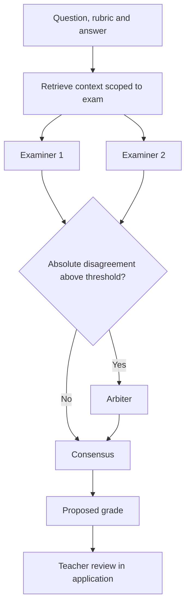

# Multi-Agent LLM Reliability & Evaluation Lab

An offline research case built on the **AI Grading System** capstone: two examiners, conditional arbitration, retrieval augmented generation (RAG), and an auditable evaluation pipeline.

**Research question:** How can we measure the consistency of a multi-agent grader, diagnose disagreements, and test whether arbitration or retrieved context improves grading?

The historical study measures **agreement and score variation**. It does not establish grading accuracy: the accessible exports contain no validated human reference grades. Synthetic response profiles are not human labels.

## Start here

- [Technical report (English)](evaluation/TECHNICAL_REPORT.md)
- [Resumo executivo (Português)](evaluation/SUMMARY_PT.md)
- [Reproduction guide and dataset provenance](evaluation/README.md)
- [Human annotation protocol](evaluation/ANNOTATION_PROTOCOL.md)
- [Arbitration and RAG experiment definitions](evaluation/EXPERIMENTS.md)
- [Validation and remaining blockers](evaluation/VALIDATION.md)

The Lab runs locally without model credentials, a database server, or paid inference. No production deployment is included. Security findings remain visible in CI; this branch does not constitute production security approval.

## Reproduce the case

Use Python 3.12 and start in the repository root:

```bash
python3.12 -m venv .venv
source .venv/bin/activate
python -m pip install -r requirements-dev.lock
python -m pytest tests/
python -m evaluation.run --output evaluation/output/reproduced
streamlit run evaluation/dashboard.py
```

The dashboard initially reads reviewed, versioned artifacts in `evaluation/data/`. Reproducing the analysis from those anonymized exports works without network access. The guide also documents how to rebuild the anonymized exports from the pinned `tcc` commit and verify their checksums.

The main historical cohorts remain separate:

| Cohort | Grading rows | Cases | Interpretation |
|---|---:|---:|---|
| QA4 JSON exports, runs 9/10/11 | 36 | 12 | Three questions × four synthetic profiles × three repetitions; exact answer text was not persisted |
| QA4 notebook, 2026-03-28 export | 12 | 4 | Q2 only × four profiles × three repetitions; a separate protocol |
| Historical A/B exports | See experiment report | Matched explicitly | Same-material matches are distinguished from fully controlled comparisons |

The largest observed final-score range is **0.625 points in the JSON QA4 cohort** and **1.37 points in the notebook QA4 cohort**, on a 0–10 scale. These values describe separate datasets and must not be pooled.

## Three experiments

1. **Reliability & Agreement.** Compare C1/C2 scores, quantify within-case score ranges, retain provenance and missingness warnings. MAE/RMSE/bias against humans are available only with validated, adjudicated human annotations. Two calls to the same model can share errors.
2. **Arbitration Effectiveness.** Simulate strict disagreement thresholds and inspect observed arbiter outcomes where recorded. Alternative thresholds do not produce new arbiter scores. Human-relative benefit, inference latency, and monetary cost remain unavailable where the required observations are absent.
3. **RAG Impact Analysis.** Match question, answer and rubric; inspect model/configuration controls and actual retrieved-context evidence. Historical score changes are descriptive when these controls are incomplete. A separate synthetic fixture tests the analytical pipeline without being reported as an empirical result.

## Existing grader architecture



The two examiner prompts do not include each other's output. If arbitration runs, the application takes the mean of the two closest scores. Otherwise it takes the mean of the examiners. The default strict threshold is 2.0 points. The Lab evaluates this existing policy; it does not silently change it.

| Component | Existing implementation |
|---|---|
| Agent orchestration | LangGraph / LangChain |
| Backend | FastAPI |
| Relational application storage | PostgreSQL |
| Retrieval | ChromaDB with exam scope |
| Experiment storage | SQLite exports |
| Offline evaluation | Python standard library |
| Results interface | Streamlit |

New grading runs capture effective configuration and source fingerprints. Retrieved contexts must be persisted explicitly; a UI label saying “RAG on” does not establish that context reached a grader. Historical missing fields are not backfilled with guesses.

## Original application setup

The full capstone application has additional provider, database and retrieval dependencies in `requirements.txt`. Its historical environment is retained separately from the smaller offline Lab environment. Consult `.env.example` for configuration and use local development only until security findings are addressed independently.

```bash
python -m pip install -r requirements.txt
cp .env.example .env
cp database.env.example database.env
# Configure local database and provider credentials in the ignored environment files.
alembic upgrade head
uvicorn src.main.server.server:app --reload --host 127.0.0.1 --port 8000
```

`DATABASE_URL`, `SECRET_KEY`, provider credentials, `EMBEDDING_PROVIDER`, `EMBEDDING_MODEL`, `RAG_TOP_K`, and `DIVERGENCE_THRESHOLD` configure the original application. The offline Lab does not need these values.

The integrated test uses the real compiled grading graph and storage with mocked external providers. It checks orchestration, arbitration routing, context evidence and persistence; it is not a new model-quality experiment. Live provider inference, real embedding retrieval and PostgreSQL deployment require separate validation.

## Research limits

- Historical responses were constructed as synthetic quality profiles for an Algorithms and Data Structures case study; this is not evidence of classroom generalization.
- Agreement is not correctness. No validated human gold standard was found in the accessible study exports.
- Missing exact QA4 answers limit repeatability claims. Missing criterion details and prompt fingerprints limit failure attribution.
- RAG comparisons require both matched material and evidence that the intended intervention actually occurred.
- Threshold simulations alone cannot justify a production arbitration threshold.
- No merge to `main` and no production deployment are part of this delivery.

## Attribution

The AI Grading System is the capstone by **Lucas Lorenzo Savino and Maycon Mendes Fernandes**, Instituto Federal Fluminense, Campos dos Goytacazes, April 2026. Advisor: Prof. Dr. Luiz Gustavo Lourenço Moura. The Lab extends the existing implementation and the repository's `tcc` historical exports. The dataset manifest identifies exact source commits and file hashes. No external human-labelled dataset is claimed.
